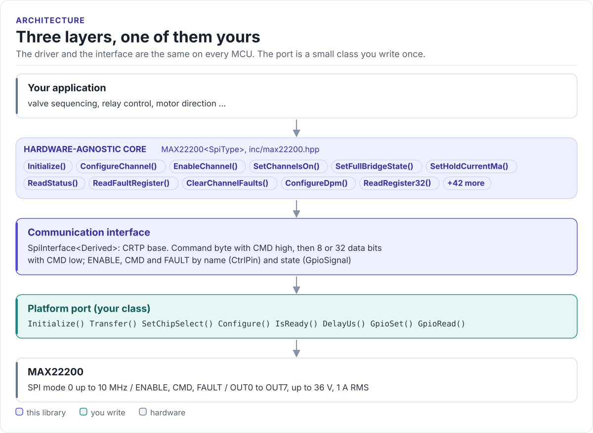

# MAX22200 Driver

A C++20 driver for the Analog Devices MAX22200 octal solenoid and motor driver: configure eight half-bridges for
current or voltage drive with HIT and HOLD levels, switch them, run full bridges and read faults, from any MCU with
SPI.

[](https://github.com/hardfoc/hf-max22200-driver/actions/workflows/ci-host-tests.yml)
[](https://github.com/hardfoc/hf-max22200-driver/actions/workflows/esp32-examples-build-ci.yml)
[](https://hardfoc.github.io/hf-max22200-driver/)
[](LICENSE)

**Documentation: <https://hardfoc.github.io/hf-max22200-driver/>**

<!-- figure: driver-layers -->
<picture>
  <source media="(prefers-color-scheme: dark)" srcset="docs/diagrams/driver-layers.dark.svg">
  
</picture>
<!-- /figure -->

## In 30 seconds

Write a small port class for your MCU (SPI transfer, ENABLE and CMD pins, FAULT input, a delay;
[Porting](https://hardfoc.github.io/hf-max22200-driver/latest/porting/)), then:

<!-- generated: quickstart-code -->
```cpp
#include "max22200.hpp"

int pull_in_solenoid_on_out0(MySpi& spi) {
  // 1. Board: RREF = 30 kOhm on IREF, so IFS = 15k x 1 V / 30 kOhm = 500 mA.
  max22200::MAX22200<MySpi> driver(spi, max22200::BoardConfig(30.0f, false));

  if (driver.Initialize() != max22200::DriverStatus::OK) {   // 2. ENABLE, STATUS, ACTIVE = 1
    return -1;                                               // wiring, SPI mode, VM
  }

  // 3. Channel 0: low-side CDR, 400 mA for 20 ms to pull in, then 150 mA to hold.
  const auto valve = max22200::ChannelConfig::makeSolenoidCdr(400.0f, 150.0f, 20.0f);
  if (driver.ConfigureChannel(0, valve) != max22200::DriverStatus::OK) {
    return -2;
  }
  return driver.EnableChannel(0) == max22200::DriverStatus::OK ? 0 : -3;   // 4. on
}
```
<!-- /generated -->

## What it does

- Runs the datasheet's start-up flow in `Initialize()`: ENABLE, the 0.5 ms wait, the UVM clear and ACTIVE = 1.
- Configures each channel in real units: HIT and HOLD in mA (CDR) or percent (VDR), HIT time in ms, from the
  board's RREF and the chip's chopping frequency.
- Switches channels with one 8-bit ONCH write; runs pairs in parallel or as full bridges (forward, reverse, brake).
- Reads STATUS and per-channel OCP, HHF, open-load and plunger-movement faults, with selective clear on the
  MAX22200A.
- No heap, no exceptions, no RTOS, no virtual calls (the port is a CRTP class).

## Install

```bash
git submodule add https://github.com/hardfoc/hf-max22200-driver.git external/hf-max22200-driver
```

```cmake
add_subdirectory(external/hf-max22200-driver)
target_link_libraries(my_app PRIVATE hf::max22200)
```

ESP-IDF: use the component wrapper in
[`examples/esp32/components/hf_max22200`](examples/esp32/components/hf_max22200/CMakeLists.txt).
Details: [Installation](https://hardfoc.github.io/hf-max22200-driver/latest/installation/).

## Documentation

| | |
| --- | --- |
| [Quickstart](https://hardfoc.github.io/hf-max22200-driver/latest/quickstart/) | Wire it, write the port, pull in a solenoid |
| [Hardware](https://hardfoc.github.io/hf-max22200-driver/latest/hardware/) | Pins, external parts, bus settings, timing, limits |
| [Drive modes](https://hardfoc.github.io/hf-max22200-driver/latest/drive-modes/) | CDR, VDR, HIT and HOLD, chopping frequency |
| [API guide](https://hardfoc.github.io/hf-max22200-driver/latest/api-guide/) | Configure, switch, bridges, faults, DPM |
| [Examples](https://hardfoc.github.io/hf-max22200-driver/latest/examples/) | ESP32 applications |
| [API reference](https://hardfoc.github.io/hf-max22200-driver/latest/api/) | Doxygen, every class and member |

The pages are in [`docs/`](docs/index.md); the datasheet is in [`docs/datasheet/`](docs/datasheet/MAX22200.pdf).

## Tests

```bash
cmake -S . -B build-host -DHF_MAX22200_BUILD_TESTS=ON && cmake --build build-host && ctest --test-dir build-host
```

The host tests run the driver against a model of the chip's SPI protocol; the code on the documentation site is
compiled by the same build.

## License

GPL-3.0. See [LICENSE](LICENSE).
