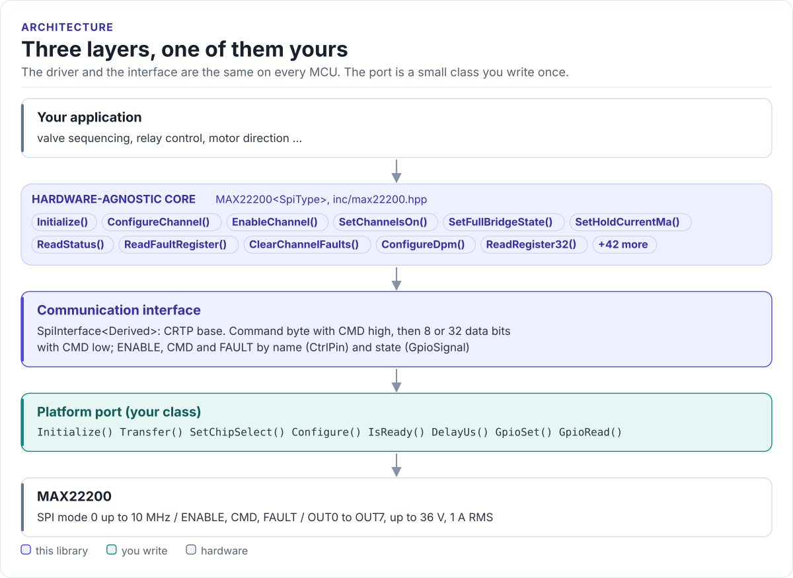
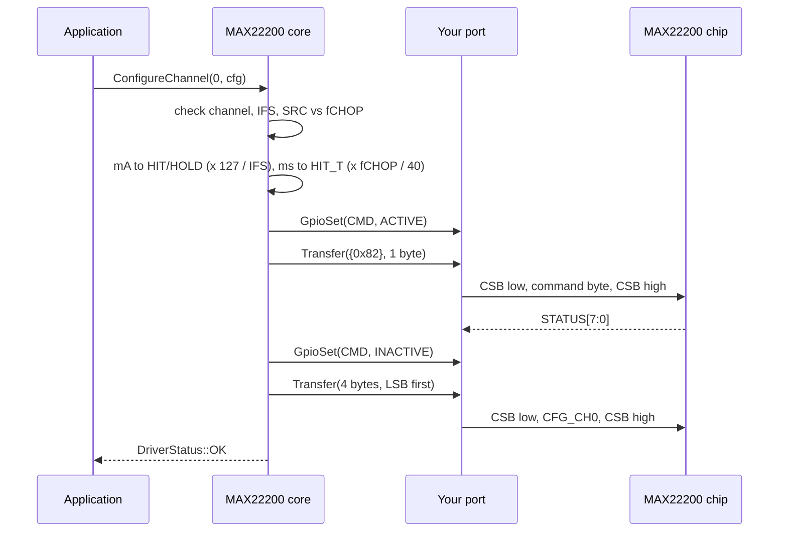

# Architecture

How the driver is put together: three layers, what each owns, and how one call reaches the chip.

<!-- figure: driver-layers -->
<picture>
  <source media="(prefers-color-scheme: dark)" srcset="diagrams/driver-layers.dark.svg">
  
</picture>
<!-- /figure -->

## The three layers

| Layer | Where | You change it when |
| --- | --- | --- |
| **Hardware-agnostic core**: `MAX22200<SpiType>` | [`inc/max22200.hpp`](../inc/max22200.hpp), [`src/max22200.ipp`](../src/max22200.ipp) | Never, for a new board |
| **Communication interface**: `SpiInterface<Derived>` | [`inc/max22200_spi_interface.hpp`](../inc/max22200_spi_interface.hpp) | Never |
| **Platform port**: your class | Your project | Once per MCU or board ([Porting](porting.md)) |

Everything above the port is the same on ESP32, STM32, a Linux host or the unit-test model. That is how the
[host tests](testing.md) run the real driver code without hardware.

## How one call reaches the chip

## Why CRTP

The interface is a class template parameter, not a virtual base class. The compiler sees your port's methods
directly and inlines them; the driver has no vtable, allocates nothing and needs no RTTI. The cost is that the
driver type names the port: `MAX22200<MySpi>`. Code that has to work with several port types takes the driver as
a template parameter too.

## State the driver keeps

The driver holds a reference to your port, never a copy, and a few values in the object:

| State | Why |
| --- | --- |
| `BoardConfig` | IFS and optional current and duty limits for every unit conversion |
| Cached STATUS | ONCH for the 8-bit channel writes, FREQM for HIT-time and duty conversions |
| Last fault byte | STATUS[7:0] from the most recent command byte (`GetLastFaultByte()`) |
| `DriverStatistics` | Transfer and failure counters |

The STATUS cache is refreshed by `ReadStatus()`, `WriteStatus()` and `Initialize()`. If something else writes
STATUS (a raw `WriteRegister32()`, another task), call `ReadStatus()` before the next `EnableChannel()`: the 8-bit
ONCH write uses the cached mask for the channels you did not name.

## Errors without exceptions

Every call that touches the chip returns `max22200::DriverStatus`:

| Value | Meaning |
| --- | --- |
| `OK` | Done |
| `INVALID_PARAMETER` | Channel above 7, pair above 3, IFS of 0, SRC at 50 kHz or more, a value out of range; nothing is written |
| `COMMUNICATION_ERROR` | Your `Transfer()` or `GpioRead()` returned `false`, or `Initialize()` saw COMER three times |
| `INITIALIZATION_ERROR` | Your `Initialize()` or `Configure()` returned `false`, or `GpioSet(ENABLE, ACTIVE)` did during `Driver::Initialize()` (nothing is sent) |
| `GPIO_ERROR` | Your `GpioSet()` returned `false` for CMD (the frame is not sent, or the access fails when CMD did not go back low) or for ENABLE in `EnableDevice()`, `DisableDevice()` and `Deinitialize()` (the device may still be enabled) |

`HARDWARE_FAULT` and `TIMEOUT` exist in the enum but no call returns them. Chip faults (overcurrent, open load) are
not errors of the call: read them with `ReadStatus()` and `ReadFaultRegister()`.

## Source map

| Path | Contents |
| --- | --- |
| `inc/max22200.hpp` | `MAX22200<SpiType>`: every public call |
| `src/max22200.ipp` | Template implementation, included by the header |
| `inc/max22200_spi_interface.hpp` | `SpiInterface<Derived>`, `CtrlPin`, `GpioSignal` |
| `inc/max22200_types.hpp` | `ChannelConfig`, `StatusConfig`, `FaultStatus`, `DpmConfig`, `BoardConfig`, enums, conversions |
| `inc/max22200_registers.hpp` | Register banks, command byte, bit fields |
| `tests/` | Host unit tests and the compiled documentation snippets |
| `examples/esp32/` | ESP-IDF applications |
