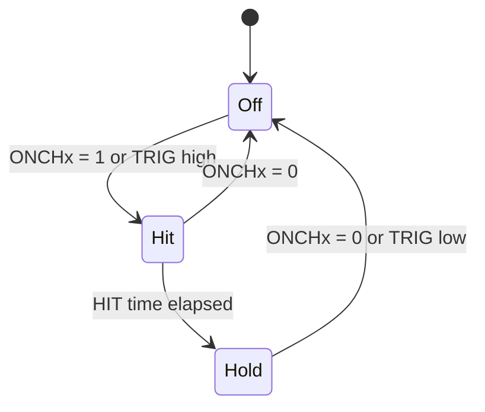

# Drive modes

What a channel does on its output in each mode, and how the driver turns milliamps, percent and milliseconds into
the CFG_CHx register.

## HIT and HOLD

Every channel runs a two-level sequence each time it is switched on (by ONCH over SPI or by its TRIG pin): a HIT
level for the HIT time, to pull a plunger in, then a lower HOLD level until it is switched off. The HOLD time is
not programmable; it lasts as long as the channel stays on.

## Current drive (CDR)

The chip senses the output current internally and chops to hold its peak at the target. CDR is the reset default
and works on low-side channels only. HIT and HOLD are 7-bit fractions of the full-scale current IFS
(datasheet Table 4):

| HIT[6:0] or HOLD[6:0] | Output |
| --- | --- |
| 0 | Off (high-side switch on, low-side off) |
| 1 to 126 | Peak current = value / 127 × IFS |
| 127 | Low-side switch fully on, no regulation |

`ChannelConfig::hit_setpoint` and `hold_setpoint` are in milliamps in CDR. The driver writes
round(mA × 127 / IFS), and writes 127 for any value at or above IFS. IFS comes from `BoardConfig`; with
`half_full_scale` set on a channel the driver uses IFS / 2 for that channel, and the chip doubles the low-side
on-resistance to 0.4 Ω. Use HFS for coils that need less than half of IFS: the resolution doubles.

The regulated value is the peak. The average current is lower by half the ripple, and the ripple grows as the
chopping frequency falls.

## Voltage drive (VDR)

The chip outputs a fixed-frequency PWM; the current follows from VM and the coil resistance. VDR is the only mode
for high-side channels (load to GND). The datasheet (Table 3) defines HIT[6:0] and HOLD[6:0] in VDR as the duty
cycle in percent: 0 is off, values from δMIN to δMAX are that duty, 100 and above is fully on, and values between
are clamped to δMIN or δMAX.

!!! warning "VDR duty is scaled by 127 / 100 in the current driver"
    `ChannelConfig::toRegister()` writes a VDR percentage as round(percent × 127 / 100), the same scaling it uses
    for CDR. By Table 3 the chip reads the register as percent, so a requested 40 % runs at 51 %. 0 % and 100 %
    are exact. Until this is fixed, write the percentage you want × 100 / 127 (40 % → 31.5), or set the field with
    `WriteRegister32()`.

## Chopping frequency

The oscillator runs at 100 kHz (`FREQM` = 0, STATUS) or 80 kHz (`FREQM` = 1) for the whole chip; each channel
divides it with `FREQ_CFG` (`ChannelConfig::chop_freq`, datasheet Table 1):

| `chop_freq` | FREQ_CFG | FREQM = 0 (kHz) | FREQM = 1 (kHz) |
| --- | --- | --- | --- |
| `FMAIN_DIV4` | 00 | 25 | 20 |
| `FMAIN_DIV3` | 01 | 33.3 | 26.6 |
| `FMAIN_DIV2` | 10 | 50 | 40 |
| `FMAIN` | 11 | 100 | 80 |

A higher frequency lowers the current ripple in CDR; a lower one lowers switching losses. The driver reads FREQM
from its cached STATUS for every conversion (`StatusConfig::master_clock_80khz`).

## Duty-cycle limits

In both modes the duty cycle is bounded by δMIN and δMAX (datasheet Table 2). `GetDutyLimits()` returns them for
a channel.

| Setting | δMIN | δMAX |
| --- | --- | --- |
| SRC = 0, `FMAIN` (100 or 80 kHz) | 8 % | 92 % |
| SRC = 0, any other divider | 4 % | 96 % |
| SRC = 1 (below 50 kHz only) | 7 % | 93 % |

## HIT time

HIT_T is 8 bits (datasheet Table 5): 0 is no HIT phase, 1 to 254 is HIT_T × 40 / fCHOP, 255 is a continuous HIT.
`hit_time_ms` is converted with the channel's fCHOP and rounded; negative values mean continuous.

| fCHOP (kHz) | Step (ms) | Longest finite HIT (ms) |
| --- | --- | --- |
| 20 | 2 | 508 |
| 25 | 1.6 | 406.4 |
| 50 | 0.8 | 203.2 |
| 100 | 0.4 | 101.6 |

The driver computes fCHOP for `FMAIN_DIV3` as 33 kHz and 26 kHz, not 33.3 and 26.6, so HIT times on that divider
read back about 1 % off.

## Slew-rate control

`slew_rate_control_enabled` (SRC) slows the output edges to about 200 ns to cut emissions, and doubles the
overcurrent deglitch time. It is low-side only and allowed only below 50 kHz: `ConfigureChannel()` returns
`INVALID_PARAMETER` for SRC at 50 kHz or more.

## Next

[API guide](api-guide.md) configures channels in code; [Configuration](configuration.md) lists every field.
