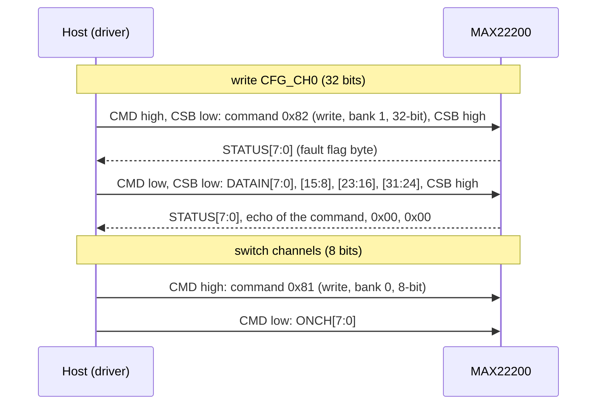

# Hardware

What to connect between your MCU and a MAX22200, with which bus settings and timing, and what the supply and
outputs need.

All values here come from the [MAX22200 datasheet](datasheet/MAX22200.pdf) (19-100531, Rev. 1, 3/25). Pin
numbers are for the 32-pin TQFN; when they disagree with a board's schematic, the schematic wins.

## Host interface pins

| Pin | Direction | Notes |
| --- | --- | --- |
| `CSB` (3) | in | SPI chip select, active low; internal pull-up current |
| `SCK` (5) | in | Data in on the rising edge, out on the falling edge; internal pull-down |
| `SDI` (6) | in | SPI data from the MCU |
| `SDO` (7) | out, open drain | Needs an external pull-up; its RC sets the highest usable clock |
| `CMD` (2) | in | High: the transfer writes the Command Register. Low: data. Internal pull-down |
| `ENABLE` (21) | in | High enables the chip, low is sleep; 1.5 MΩ internal pull-down |
| `FAULT` (1) | out, open drain | Low while an unmasked fault is present; needs a pull-up |
| `TRIGA` (8) | in | Trigger for channels 0, 2, 4, 6 when their TRGnSPI bit is set; pull-down |
| `TRIGB` (17) | in | Trigger for channels 1, 3, 5, 7; pull-down |

The driver drives ENABLE and CMD and reads FAULT through your port by name (`max22200::CtrlPin`) and state
(`GpioSignal::ACTIVE` / `INACTIVE`). ENABLE and CMD are active high, FAULT is active low; your port maps each state
to a level. TRIGA and TRIGB are not used by the driver: drive them from your own GPIOs or leave them low.

There is no separate logic supply. Logic inputs switch at 1.2 V (VIH, min) and 0.65 V (VIL,
max) and tolerate 6 V, so 1.8 V, 3.3 V and 5 V MCUs connect directly. ENABLE switches at 0.9 V / 0.6 V and is rated
to VM.

## Output and power pins

| Pin | What it is | Connect |
| --- | --- | --- |
| `OUT0` to `OUT7` | Half-bridge outputs (31, 30, 27, 26, 10, 11, 14, 15) | Low side: load to VM. High side: load to GND |
| `VM` | Supply (9, 12, 13, 16, 25, 28, 29, 32) | Two 0.1 µF ceramics at pins 12/13 and 28/29, plus 10 µF electrolytic |
| `IREF` (18) | Current reference | 15 kΩ to 100 kΩ to GND; sets IFS for CDR |
| `V18` (20) | 1.8 V internal regulator | 2.2 µF ceramic to GND |
| `VCP` (24) | Charge-pump output | 1 µF, 5 V or more, to VM |
| `CFP`, `CFN` (23, 22) | Charge-pump flying capacitor | 22 nF, VM-rated, between them |
| `GND`, `EP` | Signal ground (4, 19), power ground pad | Board ground; vias under the pad for heat |

Pairs 0-1, 2-3, 4-5 and 6-7 can be wired in parallel (outputs tied together) for twice the current, or used as a
full bridge across a motor or latching valve. Both are set in STATUS; see [API guide](api-guide.md#run-a-full-bridge).

## Full-scale current (IREF)

In CDR the HIT and HOLD currents are fractions of a full-scale current set by RREF:
IFS = KFS × 1 V / RREF, with KFS = 15 000 (HFS = 0) or 7 500 (HFS = 1,
per channel).

| RREF (kΩ) | IFS, HFS = 0 (mA) | IFS, HFS = 1 (mA) |
| --- | --- | --- |
| 15 | 1000 | 500 |
| 30 | 500 | 250 |
| 50 | 300 | 150 |
| 100 | 150 | 75 |

Pass RREF to the driver with `BoardConfig(rref_kohm, false)`; it computes IFS for HFS = 0 and halves it for any
channel with `half_full_scale` set. CDR accuracy is ±6 % from 71 % to 100 % of IFS and widens to ±25 % at 5 % to
10 % (IFS = 1 A, 1 % RREF).

## Bus settings

| Setting | Value |
| --- | --- |
| Mode | 0 (CPOL = 0, CPHA = 0), MSB first |
| Clock | Up to 10 MHz (tCLK ≥ 100 ns); 5 MHz when daisy-chained; start at 1 MHz |
| Frame | 8 bits with CMD high (command), then 8 or 32 bits with CMD low (data) |
| Chip select | Low for the whole frame; high at least 30 ns between frames |
| 32-bit byte order | Write: LSB byte first on SDI. Read: MSB byte first on SDO |

The driver supports one chip per bus; it does not build daisy-chained frames. The
[SPI protocol](spi-protocol.md) page shows every frame byte by byte.

## Timing

| Parameter | Symbol | Value |
| --- | --- | --- |
| SCK period | tCLK | ≥ 100 ns |
| SCK high, low | tCH, tCL | ≥ 30 ns each |
| CSB fall to SCK rise, CSB hold, CSB high | tCSS, tCSH, tCSPW | ≥ 30 ns each |
| SDI setup, hold | tDS, tDH | ≥ 10 ns each |
| SDO valid after SCK fall | tDO | ≤ 40 ns (310 Ω pull-up, 20 pF) |
| CMD setup before CSB | tCMS | ≥ 20 ns |
| ENABLE high to SPI ready | tEN | 0.5 ms |
| ACTIVE = 1 to outputs active | tWU | 2.5 ms |
| ENABLE low to outputs off | tDIS | 2.5 ms |

`Initialize()` waits tEN after raising ENABLE and tWU after writing ACTIVE = 1, both through
your port's `DelayUs()`, so the outputs are active when it returns. If you set ACTIVE yourself with
`WriteStatus()`, wait tWU before you expect an output to switch.

## Power

| Quantity | Value |
| --- | --- |
| VM operating range | 4.5 V to 36 V (absolute maximum 40 V) |
| Sleep current, ENABLE low | ≤ 11 µA |
| ACTIVE = 0 current | 200 µA typical, 400 µA maximum |
| Quiescent, all channels off / CDR on, no load | 2.5 mA / 5.2 mA typical |
| VM undervoltage lockout | 4 V typical rising (3.75 V to 4.25 V), 0.12 V hysteresis |

At power-up every register is at its default, ACTIVE is 0 and the UVM flag is set, so FAULT is low until the first
STATUS read. A VM dip below UVLO three-states the outputs but keeps the registers; only a dip that takes V18 below
its reset threshold (about 1 V) resets them.

## Output limits and protection

| Limit | Value |
| --- | --- |
| Output current | 1 A RMS per half-bridge recommended maximum; twice that for a parallel pair |
| On-resistance | Low side 0.2 Ω typical (0.4 Ω with HFS = 1), high side 0.21 Ω typical |
| Overcurrent threshold | 1.1 A minimum; the channel turns off and its OCP flag sets |
| Thermal shutdown | 145 °C, 20 °C hysteresis; all outputs off, operation resumes on cooling |
| Junction temperature | Keep below 125 °C (datasheet safe operating area, Figures 14 to 17) |

!!! warning "CDR, HFS, SRC and DPM are low-side only"
    A high-side channel (load to GND) runs in VDR only. The chip changes VDRnCDR and HSnLS only while every channel
    is off and TRIGA and TRIGB are low; configure drive and side right after `Initialize()`.

## Variants

| Part | FAULT register read | Use |
| --- | --- | --- |
| MAX22200AETJ+ | Selective clear on read: only bits whose SDI bit is high | New designs |
| MAX22200ETJ+ | Every read clears every bit | Compatibility with older firmware |

`ClearChannelFaults()` relies on selective clear; on the MAX22200 it clears every channel's flags.

## Reference documents

| Document | What it is for |
| --- | --- |
| [MAX22200 datasheet](datasheet/MAX22200.pdf) | Pins, electrical limits, registers, programming flow |
| [Product page](https://www.analog.com/en/products/max22200.html) | Latest datasheet, evaluation kit, application notes |

The ESP32 pin assignment used by the examples is in
[`esp32_max22200_test_config.hpp`](../examples/esp32/main/esp32_max22200_test_config.hpp).
