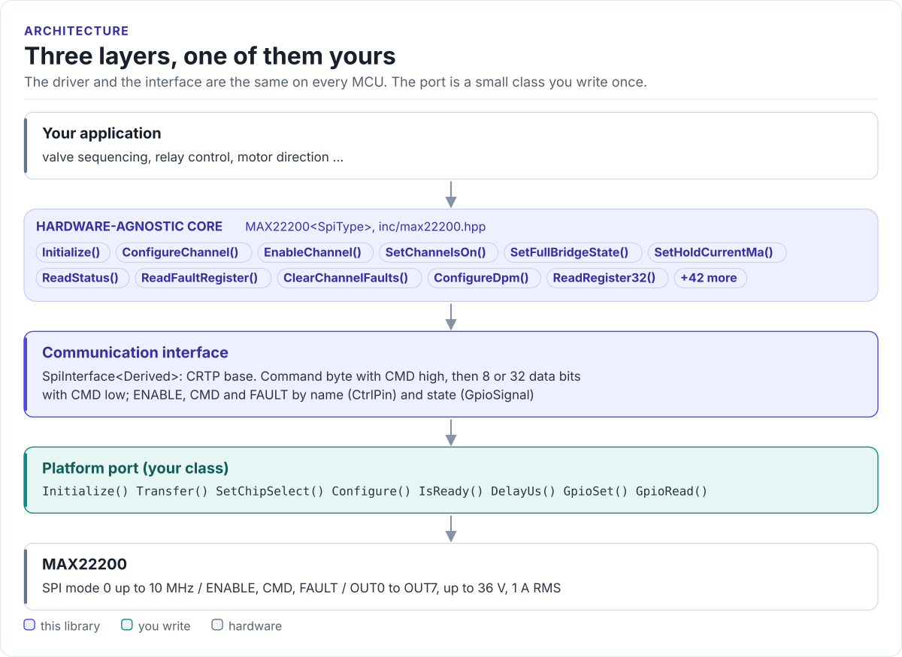

# Porting

Run the driver on a new MCU by writing one class: the SPI interface.

The driver never calls your SDK directly. It calls eight methods on a class you derive from
`max22200::SpiInterface<Self>` (in [`inc/max22200_spi_interface.hpp`](../inc/max22200_spi_interface.hpp)). The base
class uses CRTP: the calls are resolved at compile time, so there are no virtual functions, no vtable and nothing
to allocate.

<!-- figure: driver-layers -->
<picture>
  <source media="(prefers-color-scheme: dark)" srcset="diagrams/driver-layers.dark.svg">
  
</picture>
<!-- /figure -->

## What you implement

| Method | Contract |
| --- | --- |
| `Initialize()` | Bring the SPI peripheral and the GPIOs up. Called first by the driver's `Initialize()` |
| `Configure(hz, mode, msb_first)` | Called with 10 MHz, mode 0, `true`. Apply it, or keep a lower clock |
| `Transfer(tx, rx, len)` | One blocking full-duplex transaction of `len` bytes (1 or 4), CS low for all of it |
| `GpioSet(pin, signal)` | Drive `ENABLE` or `CMD`: `ACTIVE` is high for both |
| `GpioRead(pin, signal)` | Read `FAULT`: low is `ACTIVE`. Return `false` if the pin is not wired |
| `DelayUs(us)` | Block for at least that long (the 0.5 ms enable time) |
| `SetChipSelect(state)` | Required by the base class; the driver does not call it |
| `IsReady()` | Required by the base class; the driver does not call it |

## The port

```cpp title="my_spi.hpp"
--8<-- "tests/docs/my_spi.hpp:port"
```

Rules the transfer must follow:

- **SPI mode 0**, MSB first, at most 10 MHz (5 MHz with daisy-chained parts on the bus).
- **One transaction per call.** CS goes low before the first byte and high after the last; never split a call,
  never merge two. The chip counts clocks and flags a communication error on a wrong count.
- **Return after CS is high.** The driver raises CMD, calls `Transfer()` for the command byte and lowers CMD as
  soon as it returns. CMD must still be high at the CS rising edge, so a queued or DMA transfer that returns early
  breaks every access.
- **Fill `rx`.** The driver reads the fault byte and register values from it.
- **Return `false` only for a bus failure.** The driver turns it into `COMMUNICATION_ERROR`.

## Pin levels

| Pin (MCU side) | `ACTIVE` level | At power-up |
| --- | --- | --- |
| `ENABLE` (output) | high | low: chip asleep |
| `CMD` (output) | high | low |
| `FAULT` (input, pull-up) | low | low until the first STATUS read (UVM) |

A board with an inverting buffer flips the level in your `GpioSet()` or `GpioRead()`; the driver only deals in
`ACTIVE` and `INACTIVE`. If ENABLE is tied high on your board, ignore it in `GpioSet()`; if FAULT is not wired,
return `false` from `GpioRead()` and poll `ReadStatus()` instead.

## Reference implementation

The ESP32 examples use [`esp32_max22200_bus.hpp`](../examples/esp32/main/esp32_max22200_bus.hpp): an ESP-IDF
`spi_master` port with `spi_device_transmit()` (blocking, CS handled by the peripheral), `esp_rom_delay_us()` and
GPIOs for ENABLE, CMD, FAULT, TRIGA and TRIGB. Start from it for any ESP-IDF target.

## Check your port

1. Build it: the port on this page is compiled by the host CI from [`tests/docs/`](../tests/docs/my_spi.hpp), with
   the driver instantiated over it.
2. Call `Initialize()`. `OK` proves the command and data phases work: the driver reads STATUS, writes it and reads
   it back.
3. Write a channel with `ConfigureChannel()`, read it with `ReadRegister32()` and compare the raw values
   ([SPI protocol](spi-protocol.md#decoding-a-log) decodes them).
4. Watch `GetStatistics()`: `failed_transfers` should stay at zero.

## Threads

The driver is not thread-safe. Give each MAX22200 one owner task, or guard every call on a driver object (and its
port) with one mutex. Other devices can share the SPI bus: the MAX22200 only sees transfers with its own CS, and
its command stays in force between them, so locking the bus inside each `Transfer()` call is enough.
